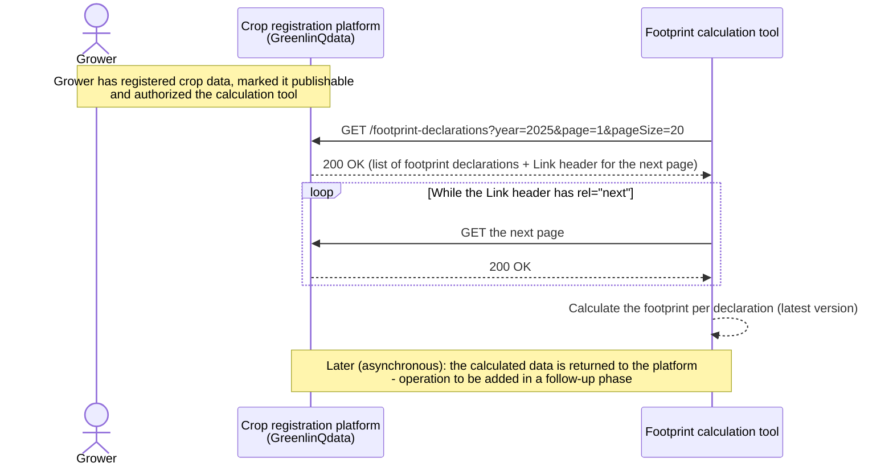

# Footprint calculation: providing crop data to an external footprint calculation tool

*eCrop API v1.1.0 — a crop registration platform provides the registered crop data of growers to an
external footprint calculation tool, which calculates the (PefCR) footprint and later (asynchronously)
returns the result to the platform. This phase covers the retrieval of the data; returning the
calculated data will be added later.*

## 1. Use case and starting points

| Actor / system | Role |
| --- | --- |
| Grower | Registers crop data on the platform (activities, products, energy, water, ...) and decides which data is publishable and which footprint calculation tool may use it — no active role in this flow, it's a precondition |
| Crop registration platform (eCrop server) | Holds the registered crop data and offers it, per grower, year and crop, as *footprint declarations*. In the examples the platform is GreenlinQdata |
| Footprint calculation tool (FPC) | An external system, acting as the eCrop API client: retrieves the footprint declarations of the growers it is authorized for and calculates the footprint |

**An external footprint calculation tool retrieves from the crop registration platform the yearly
footprint declarations (all data needed for a PefCR calculation of one crop at one production
location of one grower in one period) of all growers whose data are publishable and for which the tool is
authorized, to calculate the footprint of these crops.**

A *footprint declaration* is identified by grower, year and sequence number and can have several versions
(*versionNumber*); the highest version number is the most recent. The calculation tool therefore
works on the latest version of each declaration.

## 2. Operations used

### 2.1 Core operations for this use case

| Operation | Purpose | Why needed |
| --- | --- | --- |
| `GET /footprint-declarations` | Retrieve the footprint declarations of all growers for which the client is authorized; the optional `year` parameter restricts the result to declarations whose period (*startDate* - *endDate*) falls in that year | The only way for the calculation tool to retrieve the data it needs. The list is paginated (`page`/`pageSize` query parameters, navigation via the RFC 8288 `Link` response header) |

### 2.2 Recommended (not required)

- `GET /health` — for the calculation tool's own monitoring, e.g. to skip or retry a scheduled retrieval
  when the platform is temporarily unreachable.
- `GET /openapi.json` — the specification of this distribution, published by the platform itself.

### 2.3 Explicitly out of scope for this phase

| Domain | Operations | Why out of scope |
| --- | --- | --- |
| Returning the calculated footprint | (to be defined) | The calculation is an asynchronous process: the tool returns the result to the platform later. The operation for this will be added to the specification in a follow-up phase |
| Registering or retrieving other crop data | `/growers/...` (plots, crops, tasks, production locations, inbound deliveries), `/suppliers/...`, `/contractors/...` | The footprint declaration already contains all data the calculation needs |
| Plot geometry (OGC) | `/`, `/conformance`, `/collections`, `.../items` | Unrelated to the footprint calculation |

## 3. Example flow



### 3.1 Retrieve the footprint declarations

```http
GET /footprint-declarations?year=2025&page=1&pageSize=20
Major-Version: v1
User-Agent: footprint-calculation-tool/1.0
```

The response contains a list of declarations. The first one, shortened (each section is complete in the
OpenAPI specification; the full example is in [`examples.yaml`](examples.yaml)):

```json
[
  {
    "id": {
      "content": "4f1d2c3b-5a6e-4b7f-8c9d-0e1f2a3b4c5d",
      "schemeId": "nl.greenlinqdata.codelist.guid"
    },
    "sequenceNumber": 1,
    "versionNumber": 2,
    "versionDateTime": "2026-02-03T09:30:00+01:00",
    "thirdPartyIds": [
      { "content": "FD-2025-0001", "schemeId": "nl.greenlinqdata.codelist.footprintnummer" }
    ],
    "startDate": "2025-01-01",
    "endDate": "2025-12-31",
    "grower": {
      "thirdPartyIds": [
        { "content": "09123559", "schemeId": "nl.kvk.codelist.kvknummer" },
        { "content": "870012388392", "schemeId": "com.gs1.codelist.gln" }
      ],
      "name": "Kwekerij De Lier"
    },
    "cropSection": {
      "plantSpecies": { "species": "Solanum lycopersicum", "variety": "Merlice", "precentageMix": 100 },
      "additionalQuestions": [
        {
          "code": { "content": "GROWING_SYSTEM", "listId": "nl.agroconnect.codelist.cl265" },
          "codeValue": { "content": "SOILLESS", "listId": "nl.agroconnect.codelist.cl299" }
        }
      ]
    },
    "locationSection": { "...": "..." },
    "cultivationSection": { "...": "..." },
    "cropProtectionSection": { "...": "..." },
    "fertilizerSection": { "...": "..." },
    "energySection": { "...": "..." },
    "waterConsumptionSection": { "...": "..." },
    "wasteSection": { "...": "..." },
    "distributionSection": { "...": "..." },
    "additionalProductSection": { "...": "..." }
  }
]
```

The values in the other sections are examples: for instance the crop protection product
(`nl.ctgb.codelist.toelatingsnummer`), the fertilizer quantity and nutrients, the energy and water
consumption and the answers to the additional PefCR questions (`additionalQuestions`).

## 4. Still to be arranged

### 4.1 Returning the calculated footprint

The asynchronous return of the calculated data is not defined yet. To be decided when the operation
is added: how the result is linked to the declaration it was calculated from (id, *sequenceNumber* and
*versionNumber*), how the platform acknowledges and validates it, and how a failed or repeated
calculation is reported.

### 4.2 Security and authorization

The spec defines no `securitySchemes` yet. Specific to this case: how a grower authorizes a footprint
calculation tool, how the platform knows which growers the calling tool may see (the operation only
returns declarations "for which the client is authorized"), and how that authorization is
established, authenticated and revoked.

### 4.3 Detecting new and changed declarations

`GET /footprint-declarations` has a `year` filter and pagination, but no way to ask only for
declarations that are new or changed since the previous retrieval. The tool has to retrieve the list
periodically and compare *versionNumber* / *versionDateTime* itself. A filter such as "published since" could
be added if the list grows large.

### 4.4 Identifier schemes and code lists

The example payloads use `nl.greenlinqdata.*` identifier schemes for the ids assigned by the platform
(the example platform), and reuse the placeholder `listId` values of the specification for the coded
values (e.g. `nl.agroconnect.codelist.cl265` for the additional questions, `cl020` for units). The code
values for the PefCR questions, and for the energy, water and product types, are illustrative. These
need to be confirmed as definitive, published schemes/code lists before production use.
